<!-- owner: generated by tether from .agents/knowledge/specs/inapp-lifecycle.yaml. Do not edit; run `.agents/tool/bin/tether generate`. -->

# In-app messaging lifecycle (Android) (.agents/knowledge/specs/inapp-lifecycle.yaml, status: draft)
The MessagingInApp module fetches in-app messages for the current user (identified or anonymous) from the Gist queue API by polling, or over SSE when the server enables it for an identified user. Messages go through a Redux-style store that filters out already-shown messages, sorts by priority, matches route rules against the current screen, and then shows at most one modal at a time (GistModalActivity) and one inline message per elementId (InlineInAppMessageView). The renderer is a WebView. Showing a message sends an Opened metric, tapping an action sends Clicked (except close), and errors and dismissals reach the host via InAppEventListener. Identity comes from datapipelines over the EventBus. Identify and clearIdentify switch the user token, and reset wipes all in-app state and local storage.

- config `siteId` (default required (Builder constructor argument)): Sent as X-CIO-Site-Id on queue requests, as the siteId query param on SSE, and in the renderer config.
- config `region` (default required (Builder constructor argument)): region.code becomes the store dataCenter, sent as X-CIO-Datacenter and in the renderer config. Environment is always PROD.
- config `eventListener` (default null): When set, receives messageShown, messageDismissed, errorWithMessage and messageActionTaken for modal and inline messages. Cannot be changed after build.
- config `colorScheme` (default AUTO): AUTO follows system night mode, while LIGHT or DARK force the renderer theme. ModuleMessagingInApp.setColorScheme changes it at runtime, including for messages already on screen.
- config `inboxEventListener` (default null): Listener for visual inbox actions. Can be replaced at runtime via ModuleMessagingInApp.setInboxEventListener. Does not affect modal or inline messages.
- config `notificationInboxAccessibilityLabels` (default all labels null): TalkBack labels for the visual inbox UI only. The SDK ships no default strings.

## setup: Host calls CustomerIO.initialize with ModuleMessagingInApp in config.modules
1. CustomerIO creates the datapipelines instance first, registers all modules by name, then calls initialize on each.
2. The datapipelines constructor publishes UserChangedEvent with the restored userId and anonymousId, so modules initialized after it still receive the current identity.
3. ModuleMessagingInApp.initialize subscribes to ScreenViewedEvent, UserChangedEvent and ResetEvent on the EventBus.
4. The EventBus replays up to 100 past events to new subscribers, so a UserChangedEvent published before module init is still handled.
5. GistSdk, the store, the Queue and both lifecycle managers are lazy SDKComponent singletons, built on the first event that touches gistProvider.
6. GistSdk dispatches Initialize with siteId, dataCenter, PROD environment and colorScheme, which sets a fresh random sessionId.
7. Building GistSdk also builds PollingLifecycleManager and SseLifecycleManager, which observe ProcessLifecycleOwner on the main thread and act right away if the app is already started.
8. InAppMessagingManager wraps a thread-safe redux store whose middleware chain is logger, route change, modal display, gist view logging, queue processing, inbox processing, error logger, and listener, with ModuleMessagingInApp as the GistListener.
   ✓ the module receives the current identity even if it subscribes after the event was published
   ✓ no in-app polling or SSE starts until something first resolves gistProvider (normally the replayed UserChangedEvent)
   ✓ InAppMessagingState.pollInterval starts at 600000 ms and sseEnabled starts false

## late-init: In-app code runs before CustomerIO.initialize has registered ModuleMessagingInApp (process restored into GistModalActivity, early API call, or delayed wrapper init)
1. ModuleMessagingInApp.instance(), and every DI accessor built on it, throws IllegalStateException when the module is not registered.
2. GistModalActivity resolves the store through runCatching and finishes right away without rendering if the module is not initialized.
3. Identity events published before the module subscribes are replayed from the EventBus buffer when initialize runs.
   ✓ a restored modal activity never crashes when the SDK has not initialized yet
   ✓ the first fetch after a late init uses the identity known at init, not a stale or missing one

## fetch-polling: App foregrounded, UserChangedEvent, persistent message closed, or poll interval changed, while SSE is not active
1. On process onStart, polling starts with an immediate catch-up fetch unless shouldUseSse is true.
2. fetchInAppMessages restarts the timer with zero initial delay, so the fetch is immediate, and does nothing when SSE is active.
3. Each tick sends POST /api/v4/users with sessionId, site, datacenter, client headers, X-Gist-User-Anonymous, and the base64 user token (userId, or anonymousId if there is none).
4. A 200 body is cached per URL, and a 304 is turned back into a 200 from that cache, or left as an uncached 304 if there is none.
5. On success, regular messages plus locally eligible broadcasts go to ProcessMessageQueue, and inbox messages go to ProcessInboxMessages.
6. A 204 clears the queue, unshown inline messages and the inbox, while an uncached 304 or an error keeps only inline messages in the queue.
7. An HTTP result is dropped if an SSE snapshot or reset bumped sseMessageRevision after the request started.
8. The response headers update the poll interval (X-Gist-Queue-Polling-Interval, in seconds, positive only), the SSE flag (X-CIO-Use-SSE, false if missing) and the inbox flag (X-CIO-Inbox-Enabled, unchanged if missing).
9. A real interval change restarts the timer with initialDelay equal to the new interval, and the initial replayed value is ignored.
10. On process onStop, the timer is cancelled.
   ✓ at most one polling timer exists at a time
   ✓ no polling happens while the app is in the background or while shouldUseSse is true
   ✓ route changes and modal dismissal (except a persistent close) never trigger a network fetch

## fetch-sse: shouldUseSse becomes true (sseEnabled from the X-CIO-Use-SSE header AND a non-empty userId) while the app is in the foreground
1. Changes to sseEnabled or isUserIdentified while in the foreground start SSE and stop polling, or the reverse.
2. startConnection is a no-op if already CONNECTING or CONNECTED, and otherwise opens the SSE URL with sessionId, siteId and userToken query params.
3. Only the server's connected event triggers one HTTP fetch to backfill existing messages, because SSE only sends messages that arrive later.
4. A messages event replaces the queue as an SSE snapshot (server broadcasts are swapped for locally eligible ones), inbox_messages updates the inbox, and ttl_exceeded reconnects.
5. The heartbeat timeout is the server's heartbeat value (default 30s) plus a 5s buffer, and a timeout is treated as a retryable failure.
6. Retryable errors (IO, timeout, 408, 429, 5xx, unknown) get up to 3 retries, the first immediately and later ones after 5s, and other 4xx errors are not retried.
7. When retries run out or the error is not retryable, the client sets sseEnabled to false, which resumes polling.
8. On process onStop, the connection, heartbeat and retry jobs are stopped.
   ✓ anonymous users never use SSE, even when the server flag is on
   ✓ polling and SSE are never both active while the app is in the foreground
   ✓ the backfill fetch runs once per server-confirmed connection and not when the connection fails

## queue-processing: ProcessMessageQueue dispatched (fetch result, SSE snapshot, route change, or dismissal while on SSE)
1. Drops messages with no queueId or a queueId already in shownMessageQueueIds, de-duplicates by queueId, and sorts by priority ascending with nulls last.
2. A message matches when it has no routeRuleAndroid, or when the rule fully matches currentRoute as a regex, and a rule with a null route or an invalid regex does not match.
3. Messages with an elementId go to reconciliation, and the first route-matching message per elementId becomes ReadyToEmbed unless that element is already Embedded.
4. The first route-matching modal is dispatched as LoadMessage, but only when no modal is Loading or Displayed.
   ✓ at most one modal is Loading or Displayed at any time
   ✓ at most one inline message is active per elementId
   ✓ a message already marked shown is never queued again until reset

## route-change: ScreenViewedEvent from CustomerIO.screen or automatic activity screen tracking
1. The screen name becomes currentRoute, and an unchanged route is ignored.
2. A Loading or Displayed modal whose route rule no longer matches is dismissed with shouldLog false.
3. The local queue is processed again without a network fetch, so queued messages for the new route can show.
   ✓ the modal activity itself does not change the route (GistModalActivity returns a null screen name)
   ✓ screenViewUse InApp still updates the in-app route even though the screen event is not sent to the backend

## display-modal: LoadMessage dispatched for a modal message
1. If no modal is Displayed, starts GistModalActivity with NEW_TASK from the application context, passing the message JSON and position, and the state becomes Loading.
2. The activity parses the extras, stays untouchable and invisible, and loads the renderer WebView for the message at the requested position.
3. The renderer must bootstrap within 5s or the load fails with TIMEOUT, and the timer pauses while the view lifecycle is paused and restarts in full on resume.
4. The first routeLoaded makes the WebView visible and dispatches DisplayMessage once for this message.
5. The reducer sets Displayed and removes the message from the queue, and adds its queueId to shownMessageQueueIds only if it is not persistent.
6. When the activity sees Displayed, it becomes touchable and animates in from the top or bottom over the overlay color.
   ✓ DisplayMessage, and so the view log, the Opened metric and messageShown, fires at most once per message load
   ✓ a second LoadMessage while a modal is Displayed is turned into a ReportError and does not start another activity

## dismiss-modal: gist://close action, back press, ModuleMessagingInApp.dismissMessage, route mismatch, or activity destroyed
1. dismissMessage only acts when a modal is Displayed.
2. Back press does nothing for a persistent message, and for other messages it finishes the activity, which dismisses it in onDestroy.
3. onDestroy dispatches DismissMessage only if this activity's message is still the Displayed one, using shouldLog false for persistent messages.
4. The message is marked shown, its view is logged to Gist, and an immediate fetch runs (skipped on SSE). [when message is persistent AND shouldLog AND viaCloseAction]
5. The modal state becomes Dismissed, and the activity sees it, stops loading and animates out.
6. The queue is processed again right away so the next eligible modal can show, while in polling mode the next modal waits for the next fetch or route change. [when shouldUseSse]
   ✓ InAppEventListener.messageDismissed fires on every DismissMessage, including route-mismatch and system-action dismissals
   ✓ no metric is sent for a dismissal
   ✓ a persistent message dismissed by anything other than a close action stays eligible to show again

## display-inline: An InlineInAppMessageView (or wrapper view) with an elementId is attached while an inline message is ReadyToEmbed for that elementId
1. On attach, the controller subscribes to the store and re-evaluates only when this element's state or its route match changes.
2. A ReadyToEmbed message is loaded into a new WebView, replacing any previous message with a collapse animation first.
3. The view stays hidden until the renderer reports a size and then animates to that size.
4. routeLoaded dispatches DisplayMessage once, and the element state becomes Embedded.
5. A message that is already displayed stays visible when the route stops matching, while a message not yet displayed is hidden.
6. observeInlineMessageAvailability emits true while the element is ReadyToEmbed or Embedded and its route matches, without fetching or marking anything shown.
7. When the owner is really destroyed (not a configuration change), the message is dismissed with shouldLog false and viaCloseAction false.
   ✓ re-creating a view for an already Embedded message shows it again without a second display event
   ✓ a detached Embedded message is kept if it was already shown or is still in the server queue

## config-change: Rotation or a dark/light mode change while a message is on screen
1. GistModalActivity declares configChanges uiMode, so a night-mode change does not recreate it, and with AUTO the WebView sends the new scheme to the renderer.
2. setColorScheme updates the store, and every live EngineWebView pushes the newly resolved scheme to its renderer.
3. Rotation is not declared in configChanges, so the activity is recreated, and its onDestroy runs the normal dismiss guard (see open_questions).
4. For inline views, a configuration change releases the view without dismissing, and the new view re-embeds the Embedded message with no new display event.
   ✓ a theme change never reloads or re-tracks a message
   ✓ an inline message survives rotation without a duplicate Opened metric

## actions: User taps an action in the rendered message (the renderer calls tap with name, action, system)
1. A tap is ignored until the message has loaded a route, and any exception while handling it is caught and logged.
2. Every tap dispatches EngineAction.Tap, which calls InAppEventListener.messageActionTaken, and inline views also call their InlineMessageActionListener.
3. Dispatches DismissMessage with viaCloseAction true. [when action host is close (gist://close)]
4. Opens the url query param with ACTION_VIEW (leading whitespace trimmed) and keeps the message open. [when action host is loadPage]
5. Dismisses the current message with shouldLog false, then loads the messageId given in the query with its base64 properties, without a queueId. [when action host is showMessage]
6. Opens the URL with NEW_TASK, CLEAR_TOP and SINGLE_TOP, then dismisses with shouldLog false, and if no activity handles the URL the message stays open. [when action is not gist:// and system is true]
7. The SDK takes no navigation action, and the host handles it through the listener callbacks. [when action is not gist:// and system is false]
   ✓ listener callbacks fire before the SDK runs any default action, and the host cannot stop the default action

## load-failure: The renderer fails to load (main-frame network, HTTP or TLS error, 5s bootstrap timeout, renderer-reported failure, or WebView render process gone)
1. EngineWebView maps the failure to NETWORK, TIMEOUT, RENDER_FAILED, WEB_VIEW_CRASHED or INTERNAL_ERROR and reports only the first failure per load.
2. The controller dispatches MessageLoadingFailed, and the reducer dismisses the message without marking it shown.
3. ModuleMessagingInApp logs the error and calls InAppEventListener.errorWithMessage(message, error), which by default delegates to the single-argument overload.
   ✓ a failed message gets no Opened metric, no view log and no messageDismissed callback
   ✓ a failed message stays in the queue and can be retried on the next queue processing

## metrics: A message is displayed, an action is tapped, or an inbox message is opened or clicked
1. On DisplayMessage, InAppEventListener.messageShown is called and TrackInAppMetricEvent(Opened) is published when the message has a campaignId (deliveryId).
2. On every Tap except an action equal to gist://close, TrackInAppMetricEvent(Clicked) is published with actionName and actionValue params.
3. The Gist backend view log (POST /api/v1/logs/queue/{queueId}, or /logs/message/{messageId} without a queueId) is sent on display for non-persistent messages and on close for persistent ones.
4. Datapipelines subscribes to TrackInAppMetricEvent and sends it as an in-app TrackMetric.
5. Inbox messages send Opened only on an unopened-to-opened change and Clicked on trackMessageClicked, both only when the message is in state and has a deliveryId.
   ✓ Opened is sent at most once per display of a message, including for persistent messages
   ✓ no Dismissed metric exists, and dismissal is reported only through InAppEventListener.messageDismissed
   ✓ messages without a campaignId send no metrics but still trigger listener callbacks

## identify: CustomerIO.identify(userId) (also the SDK-init republish of a restored user)
1. Datapipelines saves the userId and publishes UserChangedEvent(userId, anonymousId) after analytics.identify.
2. The module sets anonymousId, sets the cio_anonymous_id renderer custom attribute, sets userId if it is non-null, and both setters ignore unchanged values.
3. Every UserChangedEvent calls fetchInAppMessages, which polls right away or does nothing when SSE is active.
4. Going from anonymous to identified with sseEnabled true starts SSE and stops polling.
   ✓ later queue requests carry the identified user token and X-Gist-User-Anonymous false

## clear-identify: CustomerIO.clearIdentify()
1. Datapipelines clears the secure user store, publishes ResetEvent, resets analytics, then publishes UserChangedEvent(null, newAnonymousId).
2. GistSdk dispatches Reset, clears all in-app SharedPreferences, cancels the poll timer and asks SSE to restart if it should still be used, and the module clears custom attributes.
3. Reset clears userId, anonymousId, currentRoute, the queues, the inbox, tombstones, shown ids, and the sse and inbox flags, sets a new sessionId and bumps sseMessageRevision.
4. Because sseEnabled becomes false, the SSE subscriber stops the connection.
5. The following UserChangedEvent sets the new anonymousId and fetches once as an anonymous user.
   ✓ after reset, no message shown to the previous user is treated as shown for the next user
   ✓ in-flight HTTP results from before reset are dropped by the sseMessageRevision guard
   ✓ after reset, route-gated messages wait for the next screen event because currentRoute is null

## anonymous-broadcasts: A queue response or SSE snapshot contains messages with gist.broadcast frequency settings
1. Broadcasts from the HTTP response are stored locally with a 60-minute expiry, and if a response has none, all local broadcast data and tracking is cleared.
2. A broadcast is eligible unless it was dismissed (and ignoreDismiss is false), is in its delay window, or has been shown count times, where count 0 means unlimited.
3. On display the shown count goes up, and count 1 marks the broadcast dismissed for good while a positive delay sets the next allowed time.
4. On dismissal the broadcast is marked dismissed unless ignoreDismiss is true.
   ✓ server copies of broadcasts are always replaced by the locally eligible set, for both HTTP and SSE
   ✓ broadcast frequency tracking needs a user token (userId or anonymousId), and without one it does nothing

## inbox-handoff: Queue response or SSE inbox_messages event carries inbox messages
1. Inbox messages are de-duplicated by queueId, filtered against local delete tombstones, and kept in state.inboxMessages for NotificationInbox and VisualInbox.
2. X-CIO-Inbox-Enabled controls isInboxEnabled, and turning it on, or a missing cache while on, triggers the templates and branding fetch.
   ✓ inbox messages never go through the modal or inline display pipeline

Invariants: sdk-may-be-uninitialized

Known issues (code differs from intended behavior, or accepted limitation):
- I1 [bug] expected: A displayed modal survives device rotation (re-displayed, no messageDismissed callback). | actual: GistModalActivity declares only configChanges=uiMode; rotation recreates it and onDestroy dispatches DismissMessage without an isChangingConfigurations guard (inline views have that guard).
- I3 [bug, unverified] expected: Wrapper inline in-app components do not crash when rendered before the native SDK is initialized. | actual: Flutter and React Native inline views always create InlineInAppMessageView, which resolves inAppMessagingManager and likely throws IllegalStateException when the module is not registered.
- I4 [bug] expected: The next eligible modal in the local queue shows right after the previous one is dismissed, in polling and SSE mode. | actual: Only SSE mode re-processes the local queue on dismiss; polling waits for the next poll, a route change or app foreground.
- I5 [limitation] expected: Invalid route regex handled consistently. | actual: Never shown by matchesRoute, but not dismissed by routeChangeMiddleware.
- I6 [limitation] expected: SSE failures back off before SSE is retried. | actual: The next poll with X-CIO-Use-SSE true re-enables SSE at once; with a failing stream the connect/retry/fallback cycle repeats roughly every 10s in the foreground (cycle time inferred from code).
- I8 [limitation] expected: A persistent modal is shown again only when intended by product. | actual: Dismissed by route change, system action, showMessage or activity destruction, it is not marked shown and can show again.

Undecided (ask the team before relying on either behavior):
- I2: Switching identified user A to B while SSE is connected; should the stream restart with B's token? (hypothesis that it does not)
- I9: What should EngineWebView navigation allowlisting block, given the renderer host differs from the allowed host?

## Diagram

```mermaid
flowchart TD
  subgraph setup["setup"]
    setup_register["register"]
    setup_republish_user["republish user"]
    setup_subscribe["subscribe"]
    setup_replay["replay"]
    setup_lazy_di["lazy di"]
    setup_gist_init["gist init"]
    setup_lifecycle_managers["lifecycle managers"]
    setup_store["store"]
  end
  setup_register --> setup_republish_user
  setup_republish_user --> setup_subscribe
  setup_subscribe --> setup_replay
  setup_replay --> setup_lazy_di
  setup_lazy_di --> setup_gist_init
  setup_gist_init --> setup_lifecycle_managers
  setup_lifecycle_managers --> setup_store
  subgraph late_init["late-init"]
    late_init_instance_throws["instance throws"]
    late_init_modal_guard["modal guard"]
    late_init_late_events["late events"]
  end
  late_init_instance_throws --> late_init_modal_guard
  late_init_modal_guard --> late_init_late_events
  subgraph fetch_polling["fetch-polling"]
    fetch_polling_foreground["foreground"]
    fetch_polling_external_fetch["external fetch"]
    fetch_polling_request["request"]
    fetch_polling_cache_304["cache 304"]
    fetch_polling_success["success"]
    fetch_polling_no_content["no content"]
    fetch_polling_stale_guard["stale guard"]
    fetch_polling_headers["headers"]
    fetch_polling_interval_change["interval change"]
    fetch_polling_background["background"]
  end
  fetch_polling_foreground --> fetch_polling_external_fetch
  fetch_polling_external_fetch --> fetch_polling_request
  fetch_polling_request --> fetch_polling_cache_304
  fetch_polling_cache_304 --> fetch_polling_success
  fetch_polling_success --> fetch_polling_no_content
  fetch_polling_no_content --> fetch_polling_stale_guard
  fetch_polling_stale_guard --> fetch_polling_headers
  fetch_polling_headers --> fetch_polling_interval_change
  fetch_polling_interval_change --> fetch_polling_background
  subgraph fetch_sse["fetch-sse"]
    fetch_sse_switch["switch"]
    fetch_sse_connect["connect"]
    fetch_sse_backfill["backfill"]
    fetch_sse_events["events"]
    fetch_sse_heartbeat["heartbeat"]
    fetch_sse_retry["retry"]
    fetch_sse_fallback["fallback"]
    fetch_sse_background["background"]
  end
  fetch_sse_switch --> fetch_sse_connect
  fetch_sse_connect --> fetch_sse_backfill
  fetch_sse_backfill --> fetch_sse_events
  fetch_sse_events --> fetch_sse_heartbeat
  fetch_sse_heartbeat --> fetch_sse_retry
  fetch_sse_retry --> fetch_sse_fallback
  fetch_sse_fallback --> fetch_sse_background
  subgraph queue_processing["queue-processing"]
    queue_processing_filter_sort["filter sort"]
    queue_processing_route_match["route match"]
    queue_processing_inline["inline"]
    queue_processing_modal["modal"]
  end
  queue_processing_filter_sort --> queue_processing_route_match
  queue_processing_route_match --> queue_processing_inline
  queue_processing_inline --> queue_processing_modal
  subgraph route_change["route-change"]
    route_change_set_route["set route"]
    route_change_cancel_modal["cancel modal"]
    route_change_reprocess["reprocess"]
  end
  route_change_set_route --> route_change_cancel_modal
  route_change_cancel_modal --> route_change_reprocess
  subgraph display_modal["display-modal"]
    display_modal_launch["launch"]
    display_modal_activity_setup["activity setup"]
    display_modal_bootstrap["bootstrap"]
    display_modal_route_loaded["route loaded"]
    display_modal_displayed["displayed"]
    display_modal_animate["animate"]
  end
  display_modal_launch --> display_modal_activity_setup
  display_modal_activity_setup --> display_modal_bootstrap
  display_modal_bootstrap --> display_modal_route_loaded
  display_modal_route_loaded --> display_modal_displayed
  display_modal_displayed --> display_modal_animate
  subgraph dismiss_modal["dismiss-modal"]
    dismiss_modal_api["api"]
    dismiss_modal_back["back"]
    dismiss_modal_on_destroy["on destroy"]
    dismiss_modal_persistent_close["persistent close"]
    dismiss_modal_reducer["reducer"]
    dismiss_modal_next["next"]
  end
  dismiss_modal_api --> dismiss_modal_back
  dismiss_modal_back --> dismiss_modal_on_destroy
  dismiss_modal_on_destroy -.->|"message is persistent AND shouldLog AND viaCloseAction"| dismiss_modal_persistent_close
  dismiss_modal_on_destroy --> dismiss_modal_reducer
  dismiss_modal_reducer -.->|"shouldUseSse"| dismiss_modal_next
  subgraph display_inline["display-inline"]
    display_inline_subscribe["subscribe"]
    display_inline_embed["embed"]
    display_inline_size["size"]
    display_inline_displayed["displayed"]
    display_inline_route_leaves["route leaves"]
    display_inline_availability["availability"]
    display_inline_owner_destroyed["owner destroyed"]
  end
  display_inline_subscribe --> display_inline_embed
  display_inline_embed --> display_inline_size
  display_inline_size --> display_inline_displayed
  display_inline_displayed --> display_inline_route_leaves
  display_inline_route_leaves --> display_inline_availability
  display_inline_availability --> display_inline_owner_destroyed
  subgraph config_change["config-change"]
    config_change_modal_uimode["modal uimode"]
    config_change_runtime_scheme["runtime scheme"]
    config_change_modal_rotation["modal rotation"]
    config_change_inline_recreate["inline recreate"]
  end
  config_change_modal_uimode --> config_change_runtime_scheme
  config_change_runtime_scheme --> config_change_modal_rotation
  config_change_modal_rotation --> config_change_inline_recreate
  subgraph actions["actions"]
    actions_guard["guard"]
    actions_notify["notify"]
    actions_close["close"]
    actions_load_page["load page"]
    actions_show_message["show message"]
    actions_system["system"]
    actions_custom["custom"]
  end
  actions_guard --> actions_notify
  actions_notify -.->|"action host is close (gist://close)"| actions_close
  actions_notify -.->|"action host is loadPage"| actions_load_page
  actions_notify -.->|"action host is showMessage"| actions_show_message
  actions_notify -.->|"action is not gist:// and system is true"| actions_system
  actions_notify -.->|"action is not gist:// and system is false"| actions_custom
  subgraph load_failure["load-failure"]
    load_failure_classify["classify"]
    load_failure_dispatch["dispatch"]
    load_failure_callback["callback"]
  end
  load_failure_classify --> load_failure_dispatch
  load_failure_dispatch --> load_failure_callback
  subgraph metrics["metrics"]
    metrics_opened["opened"]
    metrics_clicked["clicked"]
    metrics_gist_view_log["gist view log"]
    metrics_delivery["delivery"]
    metrics_inbox["inbox"]
  end
  metrics_opened --> metrics_clicked
  metrics_clicked --> metrics_gist_view_log
  metrics_gist_view_log --> metrics_delivery
  metrics_delivery --> metrics_inbox
  subgraph identify["identify"]
    identify_publish["publish"]
    identify_set_ids["set ids"]
    identify_fetch["fetch"]
    identify_sse_upgrade["sse upgrade"]
  end
  identify_publish --> identify_set_ids
  identify_set_ids --> identify_fetch
  identify_fetch --> identify_sse_upgrade
  subgraph clear_identify["clear-identify"]
    clear_identify_publish["publish"]
    clear_identify_reset["reset"]
    clear_identify_reset_state["reset state"]
    clear_identify_sse_stop["sse stop"]
    clear_identify_anonymous_fetch["anonymous fetch"]
  end
  clear_identify_publish --> clear_identify_reset
  clear_identify_reset --> clear_identify_reset_state
  clear_identify_reset_state --> clear_identify_sse_stop
  clear_identify_sse_stop --> clear_identify_anonymous_fetch
  subgraph anonymous_broadcasts["anonymous-broadcasts"]
    anonymous_broadcasts_store["store"]
    anonymous_broadcasts_eligible["eligible"]
    anonymous_broadcasts_seen["seen"]
    anonymous_broadcasts_dismissed["dismissed"]
  end
  anonymous_broadcasts_store --> anonymous_broadcasts_eligible
  anonymous_broadcasts_eligible --> anonymous_broadcasts_seen
  anonymous_broadcasts_seen --> anonymous_broadcasts_dismissed
  subgraph inbox_handoff["inbox-handoff"]
    inbox_handoff_ingest["ingest"]
    inbox_handoff_visual_gate["visual gate"]
  end
  inbox_handoff_ingest --> inbox_handoff_visual_gate
```

## Known issues

| ID | Kind | Verified | Expected | Actual |
|---|---|---|---|---|
| I1 | bug | yes | A displayed modal survives device rotation (re-displayed, no messageDismissed callback). | GistModalActivity declares only configChanges=uiMode; rotation recreates it and onDestroy dispatches DismissMessage without an isChangingConfigurations guard (inline views have that guard). |
| I3 | bug | no | Wrapper inline in-app components do not crash when rendered before the native SDK is initialized. | Flutter and React Native inline views always create InlineInAppMessageView, which resolves inAppMessagingManager and likely throws IllegalStateException when the module is not registered. |
| I4 | bug | yes | The next eligible modal in the local queue shows right after the previous one is dismissed, in polling and SSE mode. | Only SSE mode re-processes the local queue on dismiss; polling waits for the next poll, a route change or app foreground. |
| I5 | limitation | yes | Invalid route regex handled consistently. | Never shown by matchesRoute, but not dismissed by routeChangeMiddleware. |
| I6 | limitation | yes | SSE failures back off before SSE is retried. | The next poll with X-CIO-Use-SSE true re-enables SSE at once; with a failing stream the connect/retry/fallback cycle repeats roughly every 10s in the foreground (cycle time inferred from code). |
| I8 | limitation | yes | A persistent modal is shown again only when intended by product. | Dismissed by route change, system action, showMessage or activity destruction, it is not marked shown and can show again. |

## Needs team discussion

- **I2**: Switching identified user A to B while SSE is connected; should the stream restart with B's token? (hypothesis that it does not)
- **I9**: What should EngineWebView navigation allowlisting block, given the renderer host differs from the allowed host?

## Questions log

| ID | Status | Question | Answer |
|---|---|---|---|
| I1 | bug | Rotating a modal - dismissed or re-displayed? | Dismissed (verified). Expected: the message stays/re-displays across rotation. See known_issues I1. |
| I2 | discuss | identify(A) then identify(B) while SSE is connected may keep the stream open with A's token. | Unverified hypothesis; correct behavior needs team discussion. |
| I3 | answered | Inline view inflated before SDK init throws IllegalStateException? | Native apps are expected to create inline views after init. Note: wrapper inline components (Flutter, React Native, Expo) have no init guard either (verified), so the crash risk applies to wrappers; see known_issues I3. |
| I4 | bug | In polling mode, does the next queued modal show right after a dismiss? | No (verified): it waits for the next poll (default 10 min), a route change or app foreground. Expected: shows right after the previous one is dismissed. See known_issues I4. |
| I5 | limitation | Invalid route regex is never shown but also never dismissed on route change. Consistent? | Accepted limitation; a message that was shown should already have a valid regex. |
| I6 | limitation | After SSE falls back to polling, does X-CIO-Use-SSE true re-enable SSE immediately with no backoff? | Yes (verified). Accepted as a known limitation for now; see known_issues I6. |
| I7 | answered | Clicked is skipped only for an exact gist://close action. Correct? | Yes, intended. Only the exact close action is a close; anything else is a click. |
| I8 | limitation | A persistent modal dismissed other than by its close action can show again. Intended? | Accepted limitation. |
| I9 | discuss | EngineWebView allows navigation only to https://code.gist.build while the renderer loads from renderer.gist.build. What is it meant to block? | Unclear; needs team discussion. |
| I10 | answered | Environment is hard-coded to PROD. Any supported way to switch? | No. DEV and LOCAL exist for internal testing only. |
