<!-- owner: generated by tether from .agents/knowledge/specs/push-lifecycle.yaml. Do not edit; run `.agents/tool/bin/tether generate`. -->

# Push notification lifecycle (Android, FCM) (.agents/knowledge/specs/push-lifecycle.yaml, status: draft)
Receives FCM messages, recognizes Customer.io pushes by CIO-Delivery-ID and CIO-Delivery-Token, tracks a delivered metric once per delivery id (persisted pending entry, WorkManager job, foreground handoff to the analytics pipeline), and renders the notification (standard or live). On click, a transparent activity tracks the opened metric and resolves the deep link (customer callback, host app link, external app, launcher) using the configured PushClickBehavior. FCM tokens reach the SDK through the EventBus. Every receive and click entry point may run before CustomerIO.initialize (app killed, or a wrapper that initializes from JS/Dart), so only Android components are set up and the push module config falls back to defaults. Outcomes that matter are no duplicate or lost delivered metrics, one notification per CIO push, and a click that always lands somewhere sensible.

- config `autoTrackPushEvents` (default True): When false, delivered metrics (FCM and GCM paths) and opened metrics (click activity and launcher-intent parsing) are not tracked. Ignored on any path that runs before the SDK is initialized, where the default applies.
- config `notificationCallback` (default None): CustomerIOPushNotificationCallback. onNotificationComposed lets the app modify the NotificationCompat.Builder before the content intent is set; onNotificationClicked returning non-null takes over click navigation. Not invoked when config is the default.
- config `pushClickBehavior` (default ACTIVITY_PREVENT_RESTART): How the resolved host-app or launcher intent is started on click (RESET_TASK_STACK, ACTIVITY_PREVENT_RESTART, ACTIVITY_NO_FLAGS). Not applied to external-app links. RN and Flutter set it from JS/Dart.
- config `liveNotificationTypes` (default [] (empty set)): Built-in (enableLiveNotificationTypes) and custom (enableCustomLiveNotificationTypes) activity types. Live pushes whose notification_type is not in the set are dropped, and the live registrar only starts when the set is non-empty.
- config `liveNotificationBranding` (default None): Company name, accent color, logo and small icon applied to templated live notifications. Null falls back to FCM metadata values.
- config `liveNotificationCallback` (default None): CustomerIOLiveNotificationsCallback that renders live notifications itself. Required for custom types. Null means built-in templates.
- config `meta-data io.customer.notification_channel_id / _name / _importance` (default package name / '<app label> Notifications' / IMPORTANCE_DEFAULT): Standard notification channel id, name and importance. Invalid importance falls back to the default.
- config `meta-data io.customer.live_notification_channel_id / _name / _importance` (default '<package>_cio_live' / '<app label> Live Updates' / IMPORTANCE_HIGH): Live notification channel id, name and importance.
- config `meta-data com.google.firebase.messaging.default_notification_icon / default_notification_color` (default app icon / no tint): Small icon and tint used when the FCM notification block does not set them.

## receive: FCM delivers a message to CustomerIOFirebaseMessagingService (or a host FirebaseMessagingService forwards it), in any app state including killed
1. The manifest-registered service, or the static companion onMessageReceived called from a host service, forwards to handleMessageReceived with handleNotificationTrigger (default true).
2. Registers AndroidSDKComponent from the context once per process, without running CustomerIO.initialize or any module initialize.
3. Push module config is read from SDKComponent.modules and falls back to MessagingPushModuleConfig.default() when the module is not registered yet.
4. Messages with an empty data payload are ignored and handleMessage returns false. [when data payload is empty]
5. A message is a Customer.io push only if data has both CIO-Delivery-ID and CIO-Delivery-Token; otherwise handleMessage returns false and the host app must handle it. [when CIO-Delivery-ID or CIO-Delivery-Token missing]
6. Delivery ids are checked against an in-memory queue of the last 10 ids shared by the FCM and GCM paths; blank or already-seen ids skip delivered tracking.
7. Delivered tracking runs only when autoTrackPushEvents is true in the config the processor was built with. [when autoTrackPushEvents is false]
8. Appends a PendingPushDeliveryMetric keyed by deliveryId to the on-disk pending store before scheduling any send.
9. Enqueues unique WorkManager work named by deliveryId (KEEP, network CONNECTED); if WorkManager cannot be obtained, sends once via fire-and-forget direct HTTP instead.
10. The worker claims the pending entry, POSTs a delivered metric to /track using writeKey and apiHost saved by a previous initialize, retries on IOException, fails on other errors, and restores the entry on any failure.
11. After the push module is initialized, every process ON_START cancels each pending entry's work, claims it, and publishes a Delivered TrackPushMetricEvent through the analytics pipeline.
12. When handleNotificationTrigger is false the SDK tracks delivery but does not render, and returns true. [when handleNotificationTrigger is false]
13. If data has cioInstanceId, creates the live channel and dispatches LiveNotificationHandler off the FCM thread; the push is dropped unless notification_type is in liveNotificationTypes, and onNotificationComposed is not called. [when data contains cioInstanceId]
14. On Android O and later, creates or renames the standard channel using manifest meta-data, defaulting to the package name as id and "<app label> Notifications" as name; an existing channel with the same name is left unchanged.
15. Builds an auto-cancel notification with default sound and BigTextStyle; title and body come from data then the FCM notification block, icon and tint from the notification block then FCM manifest meta-data then the app icon.
16. If data "image" or the notification imageUrl is set, downloads it synchronously (8s budget, 5MB cap, scaled to at most 1024px) and sets BigPictureStyle plus a square large icon; any failure posts the notification without the image. [when image url present]
17. Calls notificationCallback.onNotificationComposed with the parsed payload and builder, before the content intent is attached; skipped when no callback is configured, including whenever config is the default.
18. Sets an immutable PendingIntent to NotificationClickReceiverActivity carrying the parsed payload, posts with a time-based request code as notification id, and returns true.
   ✓ Non-CIO messages are untouched and handleMessage returns false so the host app can handle them.
   ✓ A delivered metric is sent at most once per delivery id across the WorkManager job, direct-HTTP fallback and foreground handoff.
   ✓ A delivered metric is not lost if the process dies after receipt, because the pending entry is on disk before any send.
   ✓ Exactly one notification is posted per CIO push when handleNotificationTrigger is true; a failed image download never blocks the notification.
   ✓ Notification channel name and importance come only from manifest meta-data or defaults, never from code config.
   ✓ Behavior depends only on defaults and manifest meta-data when the push arrives before CustomerIO.initialize.

## receive-gcm: Google Play services broadcasts com.google.android.c2dm.intent.RECEIVE to CustomerIOCloudMessagingReceiver
1. Ignores broadcasts with no extras, otherwise sets up Android components and passes the intent to the processor.
2. Requires CIO-Delivery-ID and CIO-Delivery-Token in the intent extras, otherwise does nothing. [when delivery id or token missing]
3. Runs the same dedupe and delivered tracking as the FCM path; this path never renders a notification.
   ✓ Delivered is tracked for CIO pushes that FCM renders itself and never passes to onMessageReceived (notification-block pushes while backgrounded, per PushMessageProcessor docs).
   ✓ The shared dedupe queue prevents a second delivered metric when both the GCM receiver and the FCM service see the same delivery id in one process.

## click: User taps a notification posted by the SDK (standard or live)
1. Transparent NotificationClickReceiverActivity (singleTask, noHistory, excludeFromRecents, empty taskAffinity, not exported, not screen-tracked) sets up Android components, handles the intent from onCreate or onNewIntent, and always finishes.
2. Reads CustomerIOParsedPushPayload from the CIO_NotificationPayloadExtras extra; a missing payload or any exception is logged and nothing else happens. [when intent has no extras or no payload]
3. If autoTrackPushEvents is true and the payload has a non-blank delivery id and token, publishes an Opened TrackPushMetricEvent on the EventBus; locally started live notifications are skipped.
4. DataPipelines subscribes to TrackPushMetricEvent and tracks it as a metric event; events published before it subscribes wait in the EventBus in-memory replay buffer (100 events).
5. If notificationCallback.onNotificationClicked returns non-null, the SDK stops and the app owns navigation. [when notificationCallback set and returns non-null]
6. For a non-blank link, resolves an ACTION_VIEW intent restricted to the app's own package.
7. If the app cannot handle the link, resolves it in another app (first matching activity) and starts it directly without PushClickBehavior flags or the payload extra. [when link not handled by host app but resolvable externally]
8. With no link, or a link nothing can open, falls back to the app's launcher intent; if that also fails it logs and opens nothing.
9. Adds the payload extra to the host-app or launcher intent and starts it per pushClickBehavior (RESET_TASK_STACK uses TaskStackBuilder with parent stack; ACTIVITY_PREVENT_RESTART adds NEW_TASK and SINGLE_TOP; ACTIVITY_NO_FLAGS adds nothing).
   ✓ Deep link resolution order is callback, host app link, external app, launcher.
   ✓ Opened is published at most once per click and never for locally started live notifications.
   ✓ The trampoline activity never stays in the back stack or recents.
   ✓ The launched host activity receives the payload under CIO_NotificationPayloadExtras.

## click-launch-intent: Any app Activity is created with CIO-Delivery-ID and CIO-Delivery-Token as top-level intent extras (e.g. launcher opened from a notification the system rendered)
1. After module initialize, ON_CREATE lifecycle events are inspected for delivery extras and an Opened metric is published when autoTrackPushEvents is true.
   ✓ Opened is tracked for system-rendered CIO notifications only if the push module subscribes before or close to the launching ON_CREATE.

## token: FCM issues a new token, or the push module initializes
1. onNewToken (service or static companion) sets up Android components and publishes RegisterDeviceTokenEvent.
2. Module initialize fetches the current token (after a Google Play services check) and publishes RegisterDeviceTokenEvent when non-null.
3. DataPipelines ignores blank tokens, saves the token in GlobalPreferenceStore and sends device attributes; tokens published before init wait in the EventBus replay buffer.
   ✓ The current token is re-registered on every SDK init, so a missed onNewToken is recovered on next launch.

Invariants: sdk-may-be-uninitialized, metrics-are-a-cross-platform-contract

Known issues (code differs from intended behavior, or accepted limitation):
- P1 [bug] expected: Customer push config (autoTrackPushEvents, notificationCallback, pushClickBehavior) applies to every push and click handled after CustomerIO.initialize. | actual: pushMessageProcessor is a singleton built on first access; if that happens before init (killed-app push, common on wrappers) it keeps MessagingPushModuleConfig.default() for the rest of the process.
- P2 [bug] expected: An opened metric survives process death before SDK init, like delivered does. | actual: Opened is only published to the in-memory EventBus (replay 100); lost if the process dies before init or init never runs in it.
- P5 [bug, unverified] expected: Opened metric is tracked when a wrapper app is cold-started from a push tap and the SDK initializes later from JS/Dart. | actual: Launcher-intent tracking relies on lifecycle callbacks with replay=1, so the launch event is likely replaced before the module subscribes. Wrappers have no workaround on Android (Flutter none, React Native warm start only, Expo only with native init config).

Undecided (ask the team before relying on either behavior):
- P4: Should a live push for a disabled or not-enabled type still create the live channel and track delivered?

## Diagram

```mermaid
flowchart TD
  subgraph receive["receive"]
    receive_entry["entry"]
    receive_setup_android["setup android"]
    receive_config_fallback["config fallback"]
    receive_empty_data["empty data"]
    receive_is_cio["is cio"]
    receive_dedupe["dedupe"]
    receive_delivered_gate["delivered gate"]
    receive_delivered_pending["delivered pending"]
    receive_delivered_schedule["delivered schedule"]
    receive_delivered_worker["delivered worker"]
    receive_delivered_handoff["delivered handoff"]
    receive_display_gate["display gate"]
    receive_live_branch["live branch"]
    receive_channel["channel"]
    receive_build["build"]
    receive_image["image"]
    receive_composed_callback["composed callback"]
    receive_post["post"]
  end
  receive_entry --> receive_setup_android
  receive_setup_android --> receive_config_fallback
  receive_config_fallback -.->|"data payload is empty"| receive_empty_data
  receive_config_fallback -.->|"CIO-Delivery-ID or CIO-Delivery-Token missing"| receive_is_cio
  receive_config_fallback --> receive_dedupe
  receive_dedupe -.->|"autoTrackPushEvents is false"| receive_delivered_gate
  receive_dedupe --> receive_delivered_pending
  receive_delivered_pending --> receive_delivered_schedule
  receive_delivered_schedule --> receive_delivered_worker
  receive_delivered_worker --> receive_delivered_handoff
  receive_delivered_handoff -.->|"handleNotificationTrigger is false"| receive_display_gate
  receive_delivered_handoff -.->|"data contains cioInstanceId"| receive_live_branch
  receive_delivered_handoff --> receive_channel
  receive_channel --> receive_build
  receive_build -.->|"image url present"| receive_image
  receive_build --> receive_composed_callback
  receive_composed_callback --> receive_post
  subgraph receive_gcm["receive-gcm"]
    receive_gcm_entry["entry"]
    receive_gcm_is_cio["is cio"]
    receive_gcm_track_only["track only"]
  end
  receive_gcm_entry -.->|"delivery id or token missing"| receive_gcm_is_cio
  receive_gcm_entry --> receive_gcm_track_only
  subgraph click["click"]
    click_activity["activity"]
    click_parse["parse"]
    click_opened["opened"]
    click_opened_delivery["opened delivery"]
    click_callback["callback"]
    click_host_app_link["host app link"]
    click_external_link["external link"]
    click_launcher["launcher"]
    click_start["start"]
  end
  click_activity -.->|"intent has no extras or no payload"| click_parse
  click_activity --> click_opened
  click_opened --> click_opened_delivery
  click_opened_delivery -.->|"notificationCallback set and returns non-null"| click_callback
  click_opened_delivery --> click_host_app_link
  click_host_app_link -.->|"link not handled by host app but resolvable externally"| click_external_link
  click_host_app_link --> click_launcher
  click_launcher --> click_start
  subgraph click_launch_intent["click-launch-intent"]
    click_launch_intent_observe["observe"]
  end
  subgraph token["token"]
    token_new_token["new token"]
    token_init_fetch["init fetch"]
    token_register["register"]
  end
  token_new_token --> token_init_fetch
  token_init_fetch --> token_register
```

## Known issues

| ID | Kind | Verified | Expected | Actual |
|---|---|---|---|---|
| P1 | bug | yes | Customer push config (autoTrackPushEvents, notificationCallback, pushClickBehavior) applies to every push and click handled after CustomerIO.initialize. | pushMessageProcessor is a singleton built on first access; if that happens before init (killed-app push, common on wrappers) it keeps MessagingPushModuleConfig.default() for the rest of the process. |
| P2 | bug | yes | An opened metric survives process death before SDK init, like delivered does. | Opened is only published to the in-memory EventBus (replay 100); lost if the process dies before init or init never runs in it. |
| P5 | bug | no | Opened metric is tracked when a wrapper app is cold-started from a push tap and the SDK initializes later from JS/Dart. | Launcher-intent tracking relies on lifecycle callbacks with replay=1, so the launch event is likely replaced before the module subscribes. Wrappers have no workaround on Android (Flutter none, React Native warm start only, Expo only with native init config). |

## Needs team discussion

- **P4**: Should a live push for a disabled or not-enabled type still create the live channel and track delivered?

## Questions log

| ID | Status | Question | Answer |
|---|---|---|---|
| P1 | bug | pushMessageProcessor captures config at first access; if a push or click arrives before init, does the default config stick for the process? | Yes (verified). Expected: config set at init applies to every push handled after init in that process. See known_issues P1. |
| P2 | bug | Opened metric from a click before init: is it persisted like delivered? | No (verified). It only lives in the in-memory EventBus replay buffer. Expected: opened survives process death before init. See known_issues P2. |
| P3 | answered | Delivery worker fails without retry on first launch (no saved settings). Intended? | Yes. Settings are not available yet, so an immediate retry would fail too; the foreground handoff after init is the retry path. |
| P4 | discuss | Live channel is created before the live-type check, so a disabled type still registers a channel (and tracks delivered). Intended? | Verified behavior; owner not sure of the intended live notification behavior. Code: CustomerIOPushNotificationHandler.kt (live detection), LiveNotificationHandler.kt (type gate), livenotification/*. |
| P5 | bug | Opened tracking from launcher-intent extras with late wrapper init: do wrappers work around it? | Flutter: no workaround. React Native: only onNewIntent (warm start), not cold start. Expo: early native init only when the plugin config is set. See known_issues P5. |
| P6 | answered | GCM receiver and FCM service may both see a message; is the 10-entry in-memory dedupe the intended guard? | Yes, intended. Added to stop duplicate delivered events; CDP now also drops duplicates, but dropping obvious duplicates locally stays. |
| P7 | limitation | Notification id is a millisecond timestamp; two pushes in the same millisecond collide. Acceptable? | Accepted limitation: assumes no two pushes arrive in the same millisecond. |
| P8 | answered | Image download blocks the FCM thread for up to ~8s. Acceptable? | Yes, intended: show the image within the OS budget (~10s before the process may be killed); on failure, post without the image. |
